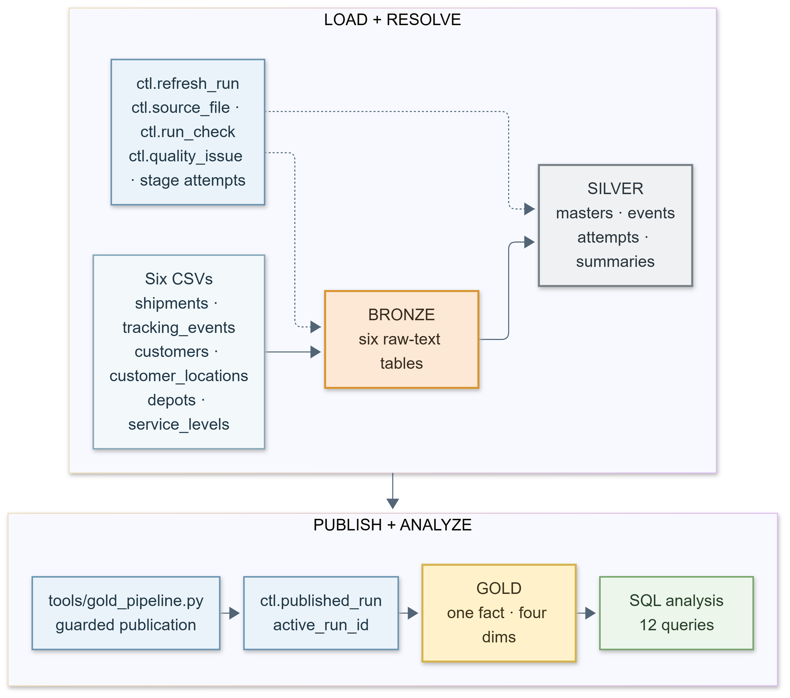
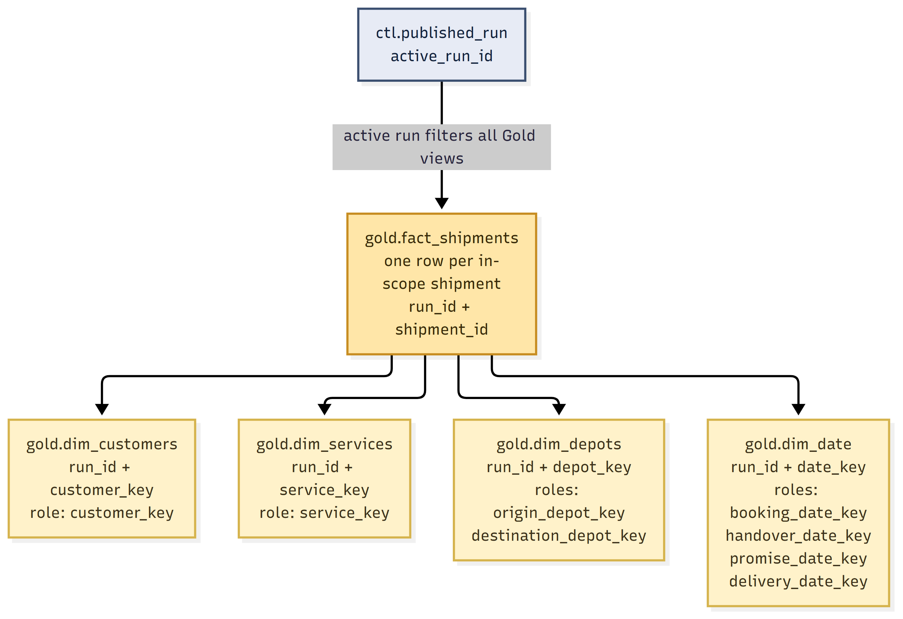

# Parcel Delivery Performance Warehouse

**SYNTHETIC — FOR LEARNING ONLY.** A SQL Server warehouse for a fictional domestic parcel network. It combines six operational CSV exports to answer a practical question: which shipments met their delivery promise, which are overdue, and where is the evidence incomplete?

The warehouse uses a full-refresh **Bronze → Silver → Gold** design. Bronze preserves raw source text and provenance. Silver resolves versions and relationships, reconciles tracking messages into physical attempts, validates source-issued attempt certificates, and produces one shipment summary. Gold publishes **one fact row per in-scope shipment**, with four dimensions and eight dimension roles. Guarded publication exposes only a validated run.



## Verified synthetic result

| Demonstration measure | Result |
| --- | ---: |
| In-scope shipments | 9,795 |
| Handed over | 9,285 |
| Due by the reporting cutoff | 8,975 |
| Confirmed on time | 6,964 / 8,975 (77.59%) |
| First physical attempt succeeded, eligible shipments | 6,335 / 8,484 (74.67%) |
| Open overdue | 650 |

These are observed outputs from the reviewed **synthetic** demonstration, not a real carrier's results. Confirmed on-time uses **all eligible due shipments** as its denominator, including unconfirmed outcomes. [Metric definitions](docs/METRIC_CATALOG.md) explain populations and exclusions; [business analysis](docs/BUSINESS_ANALYSIS.md) gives the other findings.



The eight roles are customer, service, origin depot, destination depot, booking date, handover date, promise date, and delivery date. Missing references use reserved Unknown members so a shipment is not silently dropped. See the [data catalog](docs/DATA_CATALOG.md) and [diagram index](docs/diagrams/README.md) for the data-flow, source-integration, and publication visuals.

## What's included

| Folder | Purpose |
| --- | --- |
| `datasets/clean/`, `datasets/demo/` | Six approved synthetic CSV sources per dataset. |
| `config/` | Fixed generation settings and a portable SQL connection template. |
| `tools/` | Reproducible generator, validator, and Bronze/Silver/Gold/analysis entry points. |
| `sql/` | Gold view definitions and twelve read-only business-analysis queries. |
| `tests/fixtures/known_answer/`, `tests/expected/` | A 14-shipment fixture and independent clean/demo/fixture expectations. |
| `docs/` | Source contracts, warehouse design, metrics, runbook, limitations, validation summary, and PNG/Mermaid diagrams. |

This GitHub edition leaves out the **pre-generated 57 edge-case variant folders, malformed-file cases, historical step-by-step logs, and one-time repair scripts**. They remain in the comprehensive local handover. The generator can recreate the test corpus in a temporary copy; [validation instructions](docs/VALIDATION.md) explain the exact scope. No executable warehouse path or approved clean/demo/known-answer CSV was changed for this edition.

## Run locally

Use Windows PowerShell, Python 3.12, SQL Server, and ODBC Driver 18 for SQL Server. The tested profile used Windows integrated authentication. From the project root:

```powershell
python -m venv .venv
& .\.venv\Scripts\python.exe -m pip install -r requirements-step5.txt
$configPath = Join-Path $env:TEMP ('parcel-runtime-' + [guid]::NewGuid().ToString('N') + '.json')
Copy-Item config\bronze_runtime.template.json $configPath
# Edit the private file: set your SQL Server instance and a unique new database name.
& .\.venv\Scripts\python.exe tools\bronze_pipeline.py probe --config $configPath
```

The template deliberately contains placeholders and the probe is read-only. Follow [SETUP_AND_RUN.md](docs/SETUP_AND_RUN.md) for the exact setup → load → three Silver stages → Gold validation → guarded publication → analysis sequence. `publish` changes only the explicitly selected local database's active pointer; the analysis queries read the published result. The CSV files are read by Python, so SQL Server does not need direct access to their folder.

For data-only review, the [known-answer fixture](tests/fixtures/known_answer/) contains **14 event messages** that collapse to **10 physical attempts**. Run the focused generator regression directly, or regenerate the complete edge-case corpus in a temporary project copy before running the full data validator; see [VALIDATION.md](docs/VALIDATION.md).

## Documentation and limits

Start with the [documentation map](docs/README.md). The [project specification](docs/PROJECT_SPEC.md), [six-source contracts](docs/SOURCE_CONTRACTS.md), [event/cutoff rules](docs/EVENT_AND_CUTOFF_RULES.md), [warehouse design](docs/WAREHOUSE_DESIGN.md), [source-to-target mapping](docs/SOURCE_TO_TARGET.md), and [metric catalog](docs/METRIC_CATALOG.md) contain the deeper decisions. Gold's published views use current master attributes as of export time and a generated UTC date dimension. The reporting cutoff is **2026-06-28 23:59:59 UTC**; the supplied export was available by **2026-07-07 23:59:59 UTC**. Post-cutoff events never become pre-cutoff outcomes or attempts, although evidence within a later certificate window may affect certificate trust.

The full pipeline passed a fresh isolated replay **on the same computer** in a separate SQL Server database; this ZIP contains no database or active publication. It is a learning project, not production use or a different-machine installation claim. [VALIDATION.md](docs/VALIDATION.md) records what was checked, and [LIMITATIONS.md](docs/LIMITATIONS.md) describes the boundaries. No cloud service, dashboard, pricing analysis, incremental load, or SCD2 history is included.
