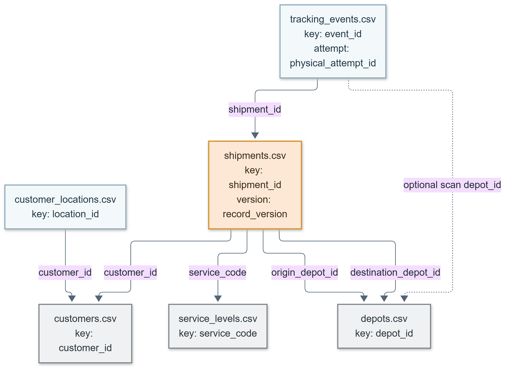

# Data catalog

**SYNTHETIC — FOR LEARNING ONLY.** This is a guide to the implemented warehouse, not a second definition of the source fields or metric formulas. For exact field names, logical types, allowed values, CSV conventions, and defect rules, use [SOURCE_CONTRACTS.md](SOURCE_CONTRACTS.md). For SQL Server column types, constraints, and indexes, use [WAREHOUSE_DESIGN.md](WAREHOUSE_DESIGN.md). The field-by-field mapping and rule order are in [SOURCE_TO_TARGET.md](SOURCE_TO_TARGET.md).

The visuals provide a quick route through the catalog: [architecture](diagrams/ARCHITECTURE_OVERVIEW.md) shows the layers, [data flow](diagrams/DATA_FLOW.md) shows the evidence rules, [source integration](diagrams/SOURCE_INTEGRATION.md) shows operational keys, and [Gold model](diagrams/GOLD_DIMENSIONAL_MODEL.md) shows reporting joins. Their PNG companions are embedded below where each relationship is explained.

## Business inputs and row grains

Exactly six CSV files enter each full-refresh run. A CSV row may be a version or duplicate of another row; it is not automatically a current business entity.

| Source file | One raw row represents | Business identity and use |
|---|---|---|
| `shipments.csv` | One exported version of one parcel booking | `shipment_id` identifies the parcel; source `record_version` selects its current booking. Customer is the paying sender. The row holds recorded booking, handover, promise, cancellation, depot assignments, and source-issued attempt certification. |
| `tracking_events.csv` | One immutable tracking **message** | `event_id` identifies the message; `shipment_id` links to a booking. Some messages share `physical_attempt_id` because one actual delivery attempt produced multiple scans. `occurred_at_utc` is event time; `recorded_at_utc` is central-system arrival time. |
| `customers.csv` | One exported version of a paying-sender account | `customer_id`; current name/segment as of export time. |
| `customer_locations.csv` | One exported version of an account site | `location_id`, with `customer_id` owner. A customer can have several sites; this is **sender account geography**, not parcel destination geography. |
| `depots.csv` | One exported version of a network depot | `depot_id`; used in origin and destination roles. |
| `service_levels.csv` | One exported version of a booked service | `service_code`; nominal hours describe the service but never replace a shipment's stored promise. |

The fixed approved run uses **T = 2026-06-28 23:59:59 UTC** (reporting cutoff) and **E = 2026-07-07 23:59:59 UTC** (export availability). The warehouse restates what *occurred* by T using evidence supplied by E. It does not recreate what operators knew at T. A pre-T delivery recorded after T can count; a delivery occurring after T cannot. Master descriptions are selected as current at E, so a historical shipment may display an E-current customer or depot label. A valid post-T booking or event remains an accepted Silver row but is separately outside the T reporting population. See [EVENT_AND_CUTOFF_RULES.md](EVENT_AND_CUTOFF_RULES.md) for boundaries and reconciliation.

## Warehouse layers and keys

| Layer | Implemented objects | Grain and key |
|---|---|---|
| Control | `ctl.refresh_run`, `ctl.source_file`, `ctl.published_run`, `ctl.publication_attempt`, `ctl.quality_issue`, `ctl.run_check`, and the three Silver stage/attempt pairs | One refresh UUID, one file record per source/run, one singleton active pointer, one record per publication attempt, potentially multiple quality reasons per source row or entity, one result per run/check, and stage-attempt history. These are technical metadata, not extra business feeds. |
| Bronze | `bronze.shipments`, `bronze.tracking_events`, `bronze.customers`, `bronze.customer_locations`, `bronze.depots`, `bronze.service_levels` | One parsed CSV data row keyed by `(run_id, source_row_number)` in its source table, with `source_file_id` and source name. Raw fields remain text, including malformed business values. A structurally invalid CSV fails file preflight rather than becoming a typed Silver row. |
| Silver resolution and references | `silver.row_resolution`, `silver.customer`, `silver.customer_location`, `silver.customer_primary_location`, `silver.depot`, `silver.service_level` | One disposition per parsed source row; one current accepted entity per `(run_id, business ID)`; one primary-location enrichment row per accepted customer. Multiple conflicting primary-site rows remain visible without multiplying the customer. |
| Silver operational evidence | `silver.shipment`, `silver.tracking_event`, `silver.event_hold`, `silver.physical_attempt`, `silver.certificate_check`, `silver.shipment_summary`, `silver.calendar_date` | One current accepted shipment, one distinct accepted message, possible row-linked uncertainty holds, one `(shipment_id, physical_attempt_id)` aggregation, one certificate check and one summary per accepted shipment, plus generated dates. Keys include `run_id`; summaries include valid bookings after T but flag them out of Gold scope. |
| Gold | `gold.dim_customers`, `gold.dim_services`, `gold.dim_depots`, `gold.dim_date`, `gold.fact_shipments` | **Five reporting views:** four dimensions and exactly one fact. Every view selects only `ctl.published_run.active_run_id` and is empty before publication. `gold.fn_*` inline functions provide the same run-parameterized projections for candidate validation. |

Gold fact identity is `(run_id, shipment_id)` with exactly one row per accepted shipment booked by T. It includes cancelled, open, delivered, returned, lost, and uncertain in-scope shipments. It does **not** have one row per event, attempt, parcel scan, or raw booking version. The fact exposes T/E, milestone timestamps, outcome, eight dimension keys, counts/eligibility flags, exclusion codes, and hours. Silver keeps exact duration seconds; Gold exposes `decimal(19,6)` hours per shipment. Summed Gold hours can differ by a tiny per-row rounding amount from the exact seconds. The [metric catalog](METRIC_CATALOG.md) defines which population uses each flag and denominator.

## Dimension relationships and Unknown members

| Gold dimension key | Fact role(s) | Key behavior |
|---|---|---|
| `customer_key` → `dim_customers.customer_key` | Paying-sender account | Source `customer_id` when current accepted account resolves; otherwise `UNK_CUSTOMER`. The dimension joins `silver.customer_primary_location`, not all location rows. |
| `service_key` → `dim_services.service_key` | Booked service | Source `service_code` or `UNK_SERVICE`. An unknown service does not erase the stored shipment promise. |
| `origin_depot_key`, `destination_depot_key` → `dim_depots.depot_key` | Assigned origin and destination | Source depot ID or `UNK_DEPOT`. Both roles use **one** depot dimension. An event scan depot is not an assigned route depot. |
| `booking_date_key`, `handover_date_key`, `promise_date_key`, `delivery_date_key` → `dim_date.date_key` | UTC calendar roles | Stable `YYYYMMDD` integer for a valid date; **0** means Unknown/not applicable. One date dimension serves all four roles. |

The sentinel keys are reserved and do not collide with source ID patterns. Current dimensions use source-issued business keys, not recalculated `ROW_NUMBER` identifiers. Gold tests verified eight roles resolve once per fact, without dropping or multiplying fact rows. The active demo has three `UNK_CUSTOMER` facts; Step 7 isolated variants tested Unknown service and depot references. A missing or conflicting customer primary site yields Unknown **geography** while keeping the accepted customer row and its shipments.

### Selected Gold column guide

This short guide highlights columns a reader will meet in the [analysis queries](../sql/analytics/). It complements the full SQL type and column contract in [WAREHOUSE_DESIGN.md](WAREHOUSE_DESIGN.md); it is not a separate formula definition.

| View | Column or group | Type / meaning |
| --- | --- | --- |
| All five views | `run_id` | `uniqueidentifier`; the active published refresh. Joins include this key. |
| `gold.fact_shipments` | `shipment_id` | Shipment business ID; `(run_id, shipment_id)` is the logical fact key. |
| `gold.fact_shipments` | `customer_key`, `service_key` | Paying-sender and booked-service dimension roles; unresolved references use reserved Unknown keys. |
| `gold.fact_shipments` | `origin_depot_key`, `destination_depot_key` | Two roles of `gold.dim_depots`, not two depot tables. |
| `gold.fact_shipments` | `booking_date_key`, `handover_date_key`, `promise_date_key`, `delivery_date_key` | Four UTC roles of `gold.dim_date`; `0` means Unknown or not applicable. |
| `gold.fact_shipments` | `reporting_cutoff_utc`, `extract_as_of_utc`, `outcome_code` | The shared occurrence cutoff, evidence availability, and resolved T outcome. |
| `gold.fact_shipments` | `is_handed_over`, `is_due`, `is_confirmed_on_time`, `is_open_overdue`, `is_tracked` | Population and event flags; apply the [metric catalog](METRIC_CATALOG.md) denominators. |
| `gold.fact_shipments` | `is_first_attempt_eligible`, `is_first_attempt_success`, `is_certificate_valid` | Completeness and first-attempt measures; a success scan alone is insufficient. |
| `gold.fact_shipments` | `transit_hours`, `overdue_hours` | `decimal(19,6)` per-row hours; Silver seconds remain the exact reconciliation basis. |
| `gold.dim_customers` | `customer_key`, `customer_segment`, `geography_status` | Current sender attributes and one primary-location selection result per accepted customer. |
| `gold.dim_services` | `service_key`, `nominal_transit_hours` | Current service label and nominal target; the booked promise remains on the shipment. |
| `gold.dim_depots` | `depot_key`, `region_code` | Current depot attributes shared by origin and destination roles. |
| `gold.dim_date` | `date_key`, `calendar_date` | UTC day member with key `YYYYMMDD`; key `0` is the reserved Unknown member. |

## Dispositions, quality, and analytical eligibility

`silver.row_resolution` assigns every parseable Bronze row exactly one final disposition: **AC** accepted clean, **AF** accepted with flags, **DX** extra byte-identical copy, **DE** extra normalized-equivalent copy, **DS** superseded coherent version, or **Q** quarantined representative. Per source, `raw = AC + AF + DX + DE + DS + Q`. `ctl.quality_issue` can hold several overlapping reasons for one row or shipment, so its reason totals are not a seventh disposition. `silver.event_hold` preserves identifiable uncertainty from quarantined or conflicting event evidence. The source rows and their original values remain in Bronze; no quarantined row is silently deleted.

An accepted source row can still be excluded from a *particular report*: future bookings are outside Gold at T; after-T events are outside T outcome/attempt/coverage counts; missing promises prevent due eligibility; a sound zero-attempt certificate gives no first-attempt denominator. `silver.shipment_summary` records reporting flags and primary exclusion codes separately from row disposition. This separation is essential when reconciling raw files to Gold. [EVENT_AND_CUTOFF_RULES.md](EVENT_AND_CUTOFF_RULES.md) gives the complete equations and precedence.

An `event_id` is a scan message identity. A `physical_attempt_id` represents one visit, potentially with several agreeing messages. `silver.physical_attempt` collapses those messages after event resolution; a successful delivery is also an attempt and is counted only once. A source-issued COMPLETE certificate in the shipment export provides a window end **W**, attestation time, and independent physical-attempt count **C**. `silver.certificate_check` validates that claim against coherent attempt evidence through W. First-attempt measurement additionally requires a valid handover and a trustworthy first attempt by T. A lone successful scan does not establish full history. If W extends after T, later evidence may affect *certificate trust*, but no later attempt or success becomes a T outcome. See [EVENT_AND_CUTOFF_RULES.md](EVENT_AND_CUTOFF_RULES.md#b-evidence-of-complete-attempt-history).

## Reporting interpretation

The Gold views support the [12 SQL analyses](../sql/analytics/) and eight approved [business questions](PROJECT_SPEC.md#2-eight-business-questions). Throughput groups by handover, due outcomes by promise, and backlog is a single T snapshot. In particular, the weekly promise cohorts group shipments by promised week and assess their **restated outcome at the one cutoff T**; they are not historical snapshots of what staff knew at each week end. Query 10 contains an `is_total=1` total row and `is_total=0` category rows. Select one level before summing, or the same handed-over shipments will be double counted.
